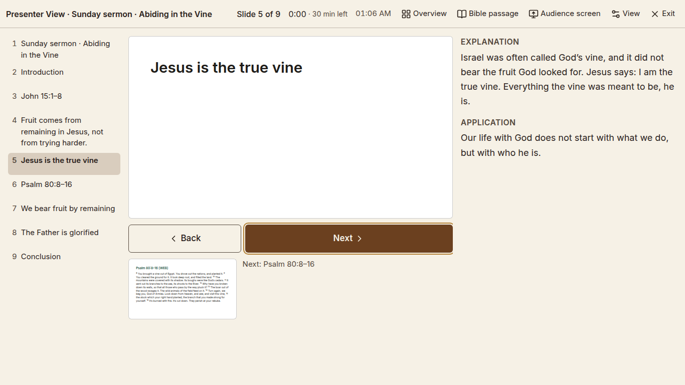

  

<h1 align="center">Abiding Word</h1>

  <strong>A Bible study workspace for your own computer</strong> 
  <em>Study with diligence. Teach with love.</em>

  
  
  
  

  

---

## What is Abiding Word?

Abiding Word helps you study the Bible carefully and prepare to teach it. It
follows one simple path:

<strong>📖 Read the Word &nbsp;→&nbsp; 💡 Understand it &nbsp;→&nbsp; 🗣️ Teach it</strong>

The Bible, your study and your own books sit **side by side** on one screen.
Everything you write is saved automatically, **on your own computer**.

## What you can do

<table>
<tr>
<td width="50%" valign="top">

### 📖 Read and mark the Bible
Go to any passage in seconds, switch translations, and highlight, annotate
and bookmark verses or single words.

</td>
<td width="50%" valign="top">

### ✍️ Write real studies
Passage, word, topic and teaching studies with ready-made sections. Capture
observations, questions and applications as you go.

</td>
</tr>
<tr>
<td valign="top">

### 📚 Keep your library beside the Bible
Add your own PDFs, e-books, Word documents and notes. Abiding Word shows which
of them talk about the passage you are reading, and why.

</td>
<td valign="top">

### 🔗 Follow every reference
Click a Bible reference in any of your books to open it, and come straight
back to your study. References are read correctly in six languages.

</td>
</tr>
<tr>
<td valign="top">

### 🔎 Concordance
See every place a word appears, grouped by book. Works with Greek and Hebrew
Bibles too.

</td>
<td valign="top">

### 🔒 Local-first, under your control
Core Bible study and writing work offline without an account. Sources, citations
and personal writing remain on your computer. An optional assistant, web search
or updater **may contact outside services when you enable or use it**; Abiding
Word shows the destination and context before assistant requests. Uncertain
reference locations remain unresolved rather than receiving invented pages.
Take a project to another computer as one file, or back up everything from
**Settings → Data and backup**. Backups containing copyrighted books or private
writing are for your own use, not public sharing.

</td>
</tr>
<tr>
<td colspan="2" valign="top">

### 📽️ Present what you teach
Slides made from your Bible Teaching that keep following it, a Presenter View
for your phone, tablet or computer, the slides on a second screen, and
PowerPoint, PDF or a phone speaker sheet to take along. Your notes are never
shown to the audience, and it all works without the internet.

</td>
</tr>
</table>

## Get started

1. **During private testing**, use the version provided for that specific
   acceptance round. The separate signed [development/test update channel](https://github.com/jc-universe87/abidingword-updates/releases)
   is **not a public stable release**; unsigned owner-acceptance builds do not
   include the updater. Extract the ZIP, verify its reported checksum and run
   the contained Windows x64 installer only when you trust its source.
2. **Add a Bible:** click **Add a Bible…**. The application includes nine
   complete editions in English, German, Korean, French, Spanish and Portuguese,
   and four Greek New Testament editions; each has a source and rights notice.
   You choose which to add to your own workspace.
3. **Start your first study:** type a passage such as `John 15:1-11` and click
   **Create study**.

👉 The **[User Guide](docs/guide/README.md)** walks you through everything,
step by step, with pictures.

> [!NOTE]
> Abiding Word is **not yet a public stable release**. The code contains
> significant Study, Teaching, presentation, export and backup functionality,
> but native Windows acceptance and the release-rights/signing review are still
> required. Test-channel builds may update; isolated acceptance installers do
> not. Your writing is local, and you should maintain full private
> [backups](docs/guide/08-settings-updates-backups.md#backups).

## What's implemented and what's still under review

| Status | Capabilities |
|---|---|
| **Implemented and exercised in tests** | Bible reading and per-verse/word notes; source library with PDF, EPUB, Word and text; backed-up projects and structured studies; user-authored Teaching, Q&A, selected Study → Teaching snapshots, material generation, presentation and export; six interface languages; optional AI assistance, disabled by default. |
| **Windows owner acceptance underway** | Complex-source navigation and multiple real PDFs, Study → Teaching → export in real Office/PDF software, leader/participant privacy, Korean DeepSeek live provider, different scaling/display settings, long-session save/reopen and full backup/restore. The existing user has confirmed **Settings → Sources → Edit details** and their supplied handbook fix, not blanket acceptance. |
| **Built in the draft release-preparation branch** | Recent-source continuity after application restart and rolling verified daily database-only safety snapshots. Both require CI and Windows acceptance before inclusion in an installer. Full `.awbackup` archives still protect original source files. |
| **Research / not shipped in this installer** | Claude's independent A1.5 Scripture-document recognition evaluation. Source-derived Bible text requires edition/provenance safety before it can be treated as verified Scripture. |
| **Later** | Scanned-page OCR, pen/stylus, device sync, collaborative publication, optional mobile editor and marketplace. |

For the current release go/no-go gates, see the [publication-readiness plan](docs/implementation/publish-readiness-20261120.md). No installer should be announced as a public stable release until those gates and the owner's distribution decision are complete.

## Documentation

| For | Read |
|---|---|
| 🙋 **Everyone** | The **[User Guide](docs/guide/README.md)**: how to use Abiding Word, in plain language |
| 🛠️ **Developers and contributors** | **[Developer guide](docs/developers.md)**: building, testing, releasing, and how the code is organised |
| 🗂️ **Project history** | **[Documentation map](docs/README.md)**: the design and the technical record of each version |

## Name, brand and bundled content rights

The Abiding Word name, logomark and brand assets are not covered by any
software licence in this repository. The fonts (Inter, Noto Serif) are SIL
Open Font License families. The thirteen bundled Bible archives include public-
domain editions, three editions under CC BY 4.0 (Schlachter 1951, Bíblia Livre
and the SBL Greek New Testament), and 성경전서 개역한글판 (1961), whose economic
copyright the Korean Bible Society says has expired, subject to attribution and
integrity rights. Each edition's exact provenance and licence evidence is in
[`resources/scripture/`](resources/scripture/README.md).

Bundled editions, including the four Greek New Testaments, have individual
source records; [distribution notices and third-party attribution](docs/release/THIRD-PARTY-NOTICES.md)
are part of the release review. **No software licence has yet been selected for
Abiding Word's own code or brand.** An open-source or commercial distribution
model requires an explicit owner choice.
