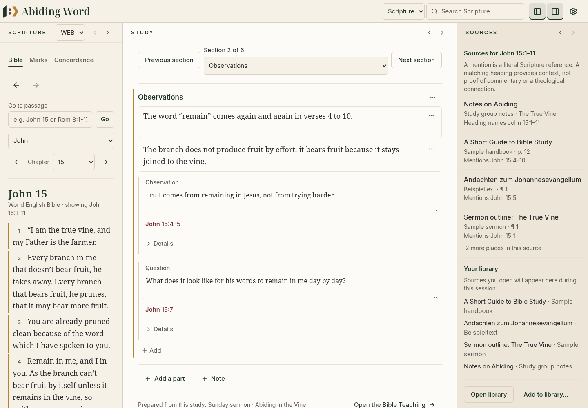
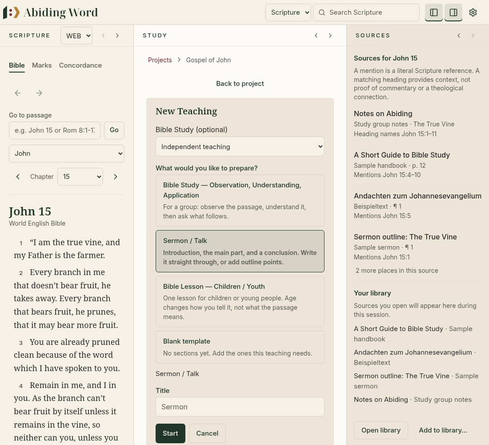

# Milestone A — Windows UX review handover

## Review boundary and exact starting point

Repository: `pistio/abidingword`. Review branch: `feature/windows-ux-milestone-a-review`.
Review target: `integration/windows-library-stage3-teaching-study`.
Verified integration head and development base: **`e2564b570abab360722d379c18955272165ec4ac`**.
The integration ref was fetched explicitly because the environment's initial remote fetch configuration tracked only `main`. The integration head was verified again before delivery. No development work was based on `main`.

Implementation commit: **2496d316dcc999ff9bcfe32e5b46fdeb5cb0fdae**. The final delivery commit adds this handover only; its exact SHA is in the delivery report.

This is Milestone A only. Stop for owner review here. Do not begin the paired Q&A/export/Study-transfer work in B, structured document recognition in C, or the architecture/catalogue research in D as part of this branch. Claude's multilingual Bible recognition remains a separate workstream. Its v0.24.3 verdict remains **NOT READY**; these application tests do not change that verdict. No recognition algorithms, fixtures or evaluation tools were modified or merged.

## What the owner can review

### Library and Sources

**Add to library → Add many sources** now reaches the existing batch importer from the everyday Library or Sources pane. Choose multiple files or a complete folder; the subfolder checkbox controls recursive scanning. The existing preview, metadata corrections, duplicate handling, collection/tag assignment, interruption/resume and commit checks are reused. Single-file import remains available. The existing 2,000-file per-batch cap remains visible, with unsupported and over-limit files reported in the review. No new scanning or copying implementation was added.

PDF Reading and Original share a visible **PDF page** field, Previous/Next and Go controls. The number is the physical page counting from the beginning of the file, including covers. A known printed label is displayed separately and never used as a physical offset. These controls use the existing reader navigation/history, preserve the view, and retain mode-transfer and return positions. Invalid numbers cannot be submitted. An asynchronous mode/page update no longer replaces a number while the person is typing it. Existing citations, text coordinates, source files and metadata are unchanged.

Sources are grouped by work under the current biblical passage. Each work shows its best location first; all additional locations are disclosed together, with the existing cached loading, keyboard/Escape, return-focus and passage-change behavior. Literal references say **Mentions**; heading evidence says **Heading names** or **Within a section headed**. The sidebar explicitly explains the evidence boundary: neither a word match nor a matching heading proves a theological relationship or genuine commentary. This branch does not add a semantic commentary classifier or claim to verify an author's explanation.

**Recently opened** now reflects opening order, deduplicated and retained for this session only. Before any source has been opened, the quick list is labelled **Your library**, rather than misrepresenting import dates as reading history. **Other sources** keeps quick access to unopened works in a compact disclosure; Open library still provides the full collection/filter/search interface. Collections, filters, quotations, source provenance, and exact reader return behavior remain on their existing paths. Reading and navigation history are not newly persisted across application restarts.

### Bible Study

The subject field changes its visible and accessible label with the study type: **Bible passage**, Word or expression, Topic, Biblical character or Book of the Bible (with appropriate labels for other/personal kinds). Passage examples include John 5:1–18 or Romans 8, localised using the existing language conventions, including the French comma.

**Step-by-step** shows one section with Previous/Next and a section selector. **Continuous writing** shows every section as one writing document. The same keyed section editors remain mounted in both views: changing modes or moving between steps neither combines stored content nor recreates the editors holding unsaved drafts. Focused headings are scrolled below the sticky controls at the actual pane width.

The previous fold/unfold-only presentation is intentionally replaced by these two distinct views. The per-study mode preference is retained; a study without a preference starts in Continuous writing, keeping free writing immediately available. Old fold preferences are not used to hide content or rewritten as study data. Legacy structured answers, ordinary paragraphs, findings and optional guidance remain intact. Additional parts can still be added and reordered.

The Ten-Step method is attributed at selection and within existing Ten-Step studies to **Helge Stadelmann and Thomas Richter, _Bibelauslegung praktisch. In zehn Schritten den Text verstehen_ (2024)**. The interface explicitly distinguishes its independently written guidance from the authors' original text. No original book text was imported or reproduced.



### Teaching

The entry actions are **+ New study** (primary) and **+ New Teaching** (secondary). The latter directly opens preparation, including when there is no Study. Existing sessions remain accessible through Teaching sessions. This uses the existing project ownership and optional Study link, with no synthetic Study creation. The creation request is transient; restoring a saved location does not continually reopen a new Teaching form.

Template and writing-view choices use responsive rounded rectangles with a visible keyboard focus indicator. There are still exactly three built-in Teaching templates, plus the existing blank/personal paths and legacy version-1 editor. Internal keys, including `eva`, remain stable. EVA appears in German only; English uses Observation, Understanding, Application, and the other four non-German languages retain natural descriptive terminology. Previously saved personal titles are not rewritten.

The optional Study relationship is a labelled disclosure on the editor's main information line, naming the current Study or the independent state. A linked Teaching is not falsely described as independent while its Study list loads. Link/unlink/relink and saved-note provenance continue through the existing service.

Participant visibility checkboxes are visible beside the writing and on section containers. Heading settings remain under the smaller settings disclosure. These checkboxes edit the existing `participantFacing` flags; the established inherited-privacy and fail-closed export/presentation logic is unchanged. Standalone Teaching, multiple sessions per Study, and behavior after Study deletion are preserved.



Both images use the repository's sample-data browser harness, invented notes and the public-domain World English Bible. They are **not Windows screenshots** or evidence of real Windows acceptance.

## Preservation and environment

The cloud runtime, native Git fetch, Node/npm, Rust and Tauri development libraries were checked before implementation. Validation uses Node 24.19.0, npm 11.9.0 and Rust 1.99.1 on Debian 13. The prepared environment activates native tools with `. /workspace/.aw-tools/env.sh`; its local libraries and WebKit filesystem mapping are outside the checkout. New tasks should use the existing isolated checkout, not create a worktree unless requested.

All **26 historical SQL migration files** were compared byte-for-byte with the exact integration base. The [independent SHA-256 manifest](milestone-a/migration-sha256.json) records all 26 files. The registry is unchanged. No new migration, schema downgrade, rewritten migration ledger, backend code, manifest, lockfile or release-workflow change is present. No real Windows profile, personal library or user backup was opened. Native tests use their existing disposable synthetic fixtures. A manual Linux startup must use a fresh disposable data directory rather than the older onboarding profile.

## Validation

Final frozen-tree validation on 31 October 2026:

| Check | Result |
| --- | --- |
| TypeScript typecheck and ESLint | Passed |
| Six-language localisation | Passed: 3,746 English keys, nine areas, 128 components |
| Derived localisation corpus | Fresh: 3,745 strings / 3,886 keys |
| Complete frontend suite | **1,157 passed, zero failed; 103 files** |
| Frontend production build | Passed; existing large-chunk advisory remains |
| Rust formatting and all-target Clippy (`-D warnings`) | Passed |
| Complete Rust suite | **1,034 passed, zero failed, eight pre-existing ignored; 85 result summaries** |
| Native development build | Passed |
| Native startup in a fresh disposable Linux profile | `startup complete`, schema 26, `integrity_check = ok`, no FK violations |
| Actual browser rendering | Passed at 900/1100/1440 pixels; rectangular choices fit the pane, focused headings clear sticky controls |
| Immutable migrations | All 26 SQL files and the registry match the integration baseline |

The complete native run includes `schema26_review`, `migration_v26`, `migration_v25`, `windows_dev44_compatibility`, `portability`, `combined_integration`, `study_flow` and `teaching_standalone`. It covers synthetic 19/24/25 upgrades, rollback, repeated startup/backups and schema-26 data preservation. The existing six-language indexing timing assertion passed unchanged.

The eight ignored checks are `document_units_dump`, `write_examples`, `real_document_editions_report`, `bundled_number_index_cost`, `oshb_corpus_reference_correctness`, `real_editions_report`, `write_interface_fixture`, and `a_whole_generated_annotated_bible_is_measured`. They are not counted as passes; no ignore or threshold was changed.

An earlier development run exposed obsolete UI expectations and real page-form/source-browsing issues. The final complete run above uses the corrected frozen source tree. A SHA-256 inventory of application/test/resource/script files was captured before validation and checked afterwards; no source drift occurred. Targeted successes are not substituted for this complete passing run.

The new and updated UI regressions cover folder recursion and multiple-file entry, review before import, physical versus printed PDF pages, page limits, mode handoff, Back/Forward, typing during asynchronous page changes, actual opening history and browsing disclosures, clear labels in all six languages, attribution, focused/continuous preservation, standalone Teaching, optional linking and participant privacy. Existing tests were updated for changed labels and the replacement of folding with section focus; assertions and timing thresholds were not weakened.

Full checks are run sequentially; the native suite uses one test thread so the existing Library timing test is not competing with frontend compilation. Commands from the application checkout:

```sh
npm run typecheck
npm run lint
npm run i18n:check
node scripts/i18n-corpus.mjs --check
npm test -- --maxWorkers=2
npm run build
. /workspace/.aw-tools/env.sh
cargo fmt --manifest-path src-tauri/Cargo.toml -- --check
cargo clippy --manifest-path src-tauri/Cargo.toml --all-targets --locked -- -D warnings
cargo test --manifest-path src-tauri/Cargo.toml --locked --no-fail-fast -- --test-threads=1
cargo build --manifest-path src-tauri/Cargo.toml --locked
```

For native development in this prepared cloud environment, use the tested disposable profile (or prepare another disposable root):

```sh
. /workspace/.aw-tools/env.sh
export ABIDING_WORD_DATA_DIR=/workspace/.aw-tools/milestone-a/native-data
export XDG_DATA_HOME=/workspace/.aw-tools/milestone-a/native-runtime/data
export XDG_CONFIG_HOME=/workspace/.aw-tools/milestone-a/native-runtime/config
export XDG_CACHE_HOME=/workspace/.aw-tools/milestone-a/native-runtime/cache
mkdir -p "$XDG_DATA_HOME" "$XDG_CONFIG_HOME" "$XDG_CACHE_HOME"
cd /workspace/abidingword
bash /workspace/.aw-tools/with-webkit.sh xvfb-run -a dbus-run-session -- npm run tauri dev
```

Raw onboarding-task evidence and the independent 26-file migration SHA-256 manifest are retained in `/workspace/.aw-tools/milestone-a/`. Logs from the earlier main/schema-10 environment setup are not counted as Milestone A validation. The localisation review documents are generated from the six packs; their audit findings are guidance, not native-speaker approval.

## Windows owner acceptance and next action

Use an explicitly approved, disposable Windows profile and a separately authorised installer/build process. This task does not dispatch GitHub Actions, publish installers, merge to main, access NiPogi, or touch actual Windows user data. Commits use `[skip ci]` to avoid automatic CI charges. Review this feature branch against the integration branch first.

The existing schema-26 acceptance workflow still pins the older approved source `6da1ea3d757d76b1072338f36c331dffc764b8ff`; it was not edited. Running that workflow unchanged would not build Milestone A. A future separately approved build must record the exact reviewed Milestone A commit.

On Windows, check:

1. Native multi-file/folder pickers, cancelled selection, recursive and nonrecursive imports; confirm duplicates/unsupported files stay reviewable.
2. Long and scanned PDFs, covers/Roman numerals, Reading/Original handoff, history, saved quotations and pane/full-reader return positions. No OCR or new document-structure inference is promised by A.
3. Step navigation and continuous writing with real keyboard input, pending autosave, a restored legacy structured Study, adding/reordering parts, and the Ten-Step attribution.
4. New Study versus New Teaching, all three built-ins, blank/personal/legacy sessions, optional Study links, multiple sessions, Study deletion and saved citations.
5. Parent/private Teaching blocks with a distinct leader-only sentinel: inspect actual participant handouts, DOCX and presentation output before acceptance.
6. All six languages, keyboard focus, narrow/wide windows and 100/125/150/200% Windows scaling.

The first push of the initial unpublished branch was rejected by GitHub email-privacy protection (GH007). The identical tested application tree was recreated on this delivery branch using the repository owner’s verified GitHub no-reply address. The original unpublished branch is retained locally; no remote history was rewritten and no force-push was used.

Draft PR delivery is currently blocked by GitHub API access. Native Git fetch/push uses the working HTTPS route, but the running enforced policy omits `api.github.com`, and the actual GitHub API preflight returned `Forbidden`. No PR number or created-PR URL is claimed. The additional hostname has been saved in the environment configuration draft; saving a draft does not apply it to this runtime. Review/save the pending environment setting and publish/apply the updated environment before retrying. No new token requirement has been established.

The complete [prepared PR description](milestone-a/pr-body.md) is included here so delivery can be resumed without reconstructing context. After API access is restored:

```sh
gh pr create --repo pistio/abidingword --draft \
  --base integration/windows-library-stage3-teaching-study \
  --head feature/windows-ux-milestone-a-review \
  --title "Milestone A: refine Library, Study and Teaching workflows" \
  --body-file docs/implementation/milestone-a/pr-body.md
```

Keep this a draft targeting the integration branch. A branch or comparison page is not an existing PR.

Milestone B starts only after this review boundary. B/C retain their separate future implementation reviews; D remains architecture and rights/catalogue research only.
